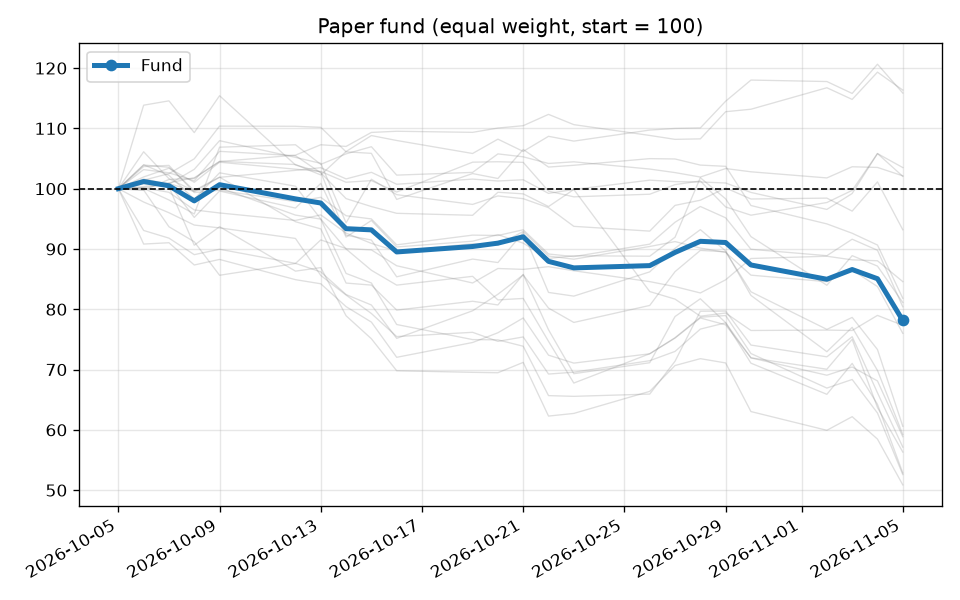

# Paper fund tracker

**Fund value: 83.94** (as of 2026-11-13, start = 100)

| Period | Return |
|---|---|
| 1 day | -1.24% |
| 1 week | +5.26% |
| 1 month | -14.01% |
| Since start | -16.06% |

**Best 3 since start**

- MA: +17.29%
- GILD: +16.21%
- HUM: +11.60%

**Worst 3 since start**

- STX: -40.45%
- CRDO: -38.11%
- FLEX: -35.78%

## Revolut forecast vs actual

Forecast snapshot from 2026-10-05. Horizon not stated by Revolut; assumed 12 months.

- Fund promised: **+37.25%** in 12 months
- Pro-rated for 39 days (capped at 12 months): +3.98%
- Actual so far: **-16.06%**

| Stock | Promised | Actual |
|---|---|---|
| MA | +31.18% | +17.29% |
| GILD | +28.18% | +16.21% |
| HUM | +48.65% | +11.60% |
| AMZN | +30.67% | +6.07% |
| MSFT | +29.90% | -0.25% |
| AVGO | +56.39% | -4.28% |
| CNH | +29.83% | -10.45% |
| PLTR | +30.42% | -11.30% |
| ORCL | +34.94% | -11.70% |
| AFRM | +34.11% | -12.90% |
| NU | +33.48% | -12.91% |
| CIEN | +41.51% | -28.01% |
| AMAT | +33.81% | -31.68% |
| NVDA | +56.21% | -31.83% |
| WDC | +48.84% | -33.06% |
| COHR | +34.52% | -34.62% |
| FIX | +28.46% | -35.00% |
| FLEX | +29.57% | -35.78% |
| CRDO | +28.09% | -38.11% |
| STX | +56.29% | -40.45% |

_Imaginary equal-weight buy-and-hold fund, not a real investment._
