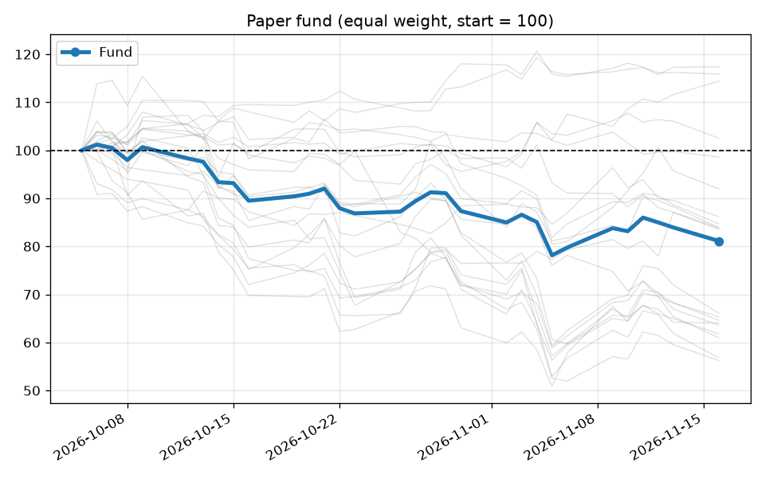

# Paper fund tracker

**Fund value: 79.25** (as of 2026-11-19, start = 100)

| Period | Return |
|---|---|
| 1 day | -1.29% |
| 1 week | -6.75% |
| 1 month | -12.34% |
| Since start | -20.75% |

**Best 3 since start**

- GILD: +15.14%
- MA: +11.13%
- AMZN: +2.37%

**Worst 3 since start**

- CRDO: -42.14%
- STX: -41.22%
- NVDA: -38.89%

## Revolut forecast vs actual

Forecast snapshot from 2026-10-05. Horizon not stated by Revolut; assumed 12 months.

- Fund promised: **+37.25%** in 12 months
- Pro-rated for 45 days (capped at 12 months): +4.59%
- Actual so far: **-20.75%**

| Stock | Promised | Actual |
|---|---|---|
| GILD | +28.18% | +15.14% |
| MA | +31.18% | +11.13% |
| AMZN | +30.67% | +2.37% |
| AVGO | +56.39% | -4.38% |
| MSFT | +29.90% | -4.93% |
| HUM | +48.65% | -5.76% |
| CNH | +29.83% | -15.49% |
| PLTR | +30.42% | -17.28% |
| NU | +33.48% | -20.42% |
| AFRM | +34.11% | -21.19% |
| ORCL | +34.94% | -22.11% |
| CIEN | +41.51% | -32.61% |
| WDC | +48.84% | -32.80% |
| FIX | +28.46% | -34.91% |
| COHR | +34.52% | -35.58% |
| FLEX | +29.57% | -36.43% |
| AMAT | +33.81% | -37.40% |
| NVDA | +56.21% | -38.89% |
| STX | +56.29% | -41.22% |
| CRDO | +28.09% | -42.14% |

_Imaginary equal-weight buy-and-hold fund, not a real investment._
