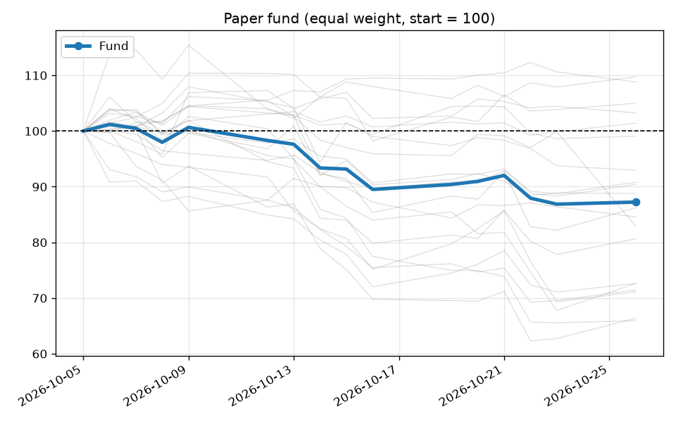

# Paper fund tracker

**Fund value: 87.24** (as of 2026-10-26, start = 100)

| Period | Return |
|---|---|
| 1 day | +0.43% |
| 1 week | -3.51% |
| Since start | -12.76% |

**Best 3 since start**

- GILD: +9.72%
- MA: +8.83%
- PLTR: +4.98%

**Worst 3 since start**

- FLEX: -34.06%
- COHR: -33.61%
- CRDO: -28.86%

## Revolut forecast vs actual

Forecast snapshot from 2026-10-05. Horizon not stated by Revolut; assumed 12 months.

- Fund promised: **+37.25%** in 12 months
- Pro-rated for 21 days (capped at 12 months): +2.14%
- Actual so far: **-12.76%**

| Stock | Promised | Actual |
|---|---|---|
| GILD | +28.18% | +9.72% |
| MA | +31.18% | +8.83% |
| PLTR | +30.42% | +4.98% |
| HUM | +48.65% | +3.25% |
| MSFT | +29.90% | +1.41% |
| AMZN | +30.67% | -0.92% |
| AFRM | +34.11% | -7.04% |
| AVGO | +56.39% | -9.20% |
| NVDA | +56.21% | -9.59% |
| ORCL | +34.94% | -11.20% |
| CIEN | +41.51% | -13.80% |
| CNH | +29.83% | -15.41% |
| NU | +33.48% | -17.06% |
| WDC | +48.84% | -19.36% |
| FIX | +28.46% | -27.37% |
| STX | +56.29% | -27.38% |
| AMAT | +33.81% | -28.53% |
| CRDO | +28.09% | -28.86% |
| COHR | +34.52% | -33.61% |
| FLEX | +29.57% | -34.06% |

_Imaginary equal-weight buy-and-hold fund, not a real investment._
